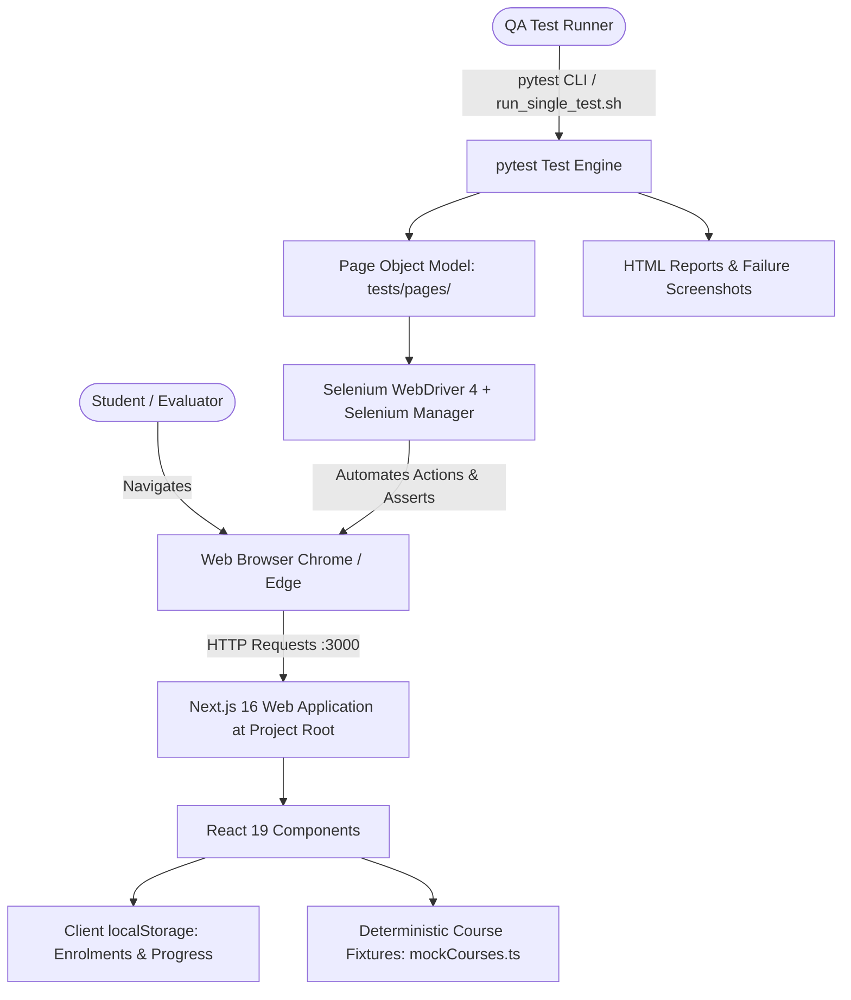

# SkillSpring — Comprehensive Project Documentation

> **Academic Project Submission — BCA Final Year**  
> **Course:** Bachelor of Computer Applications (BCA)  
> **Project Title:** SkillSpring — Learning Management Portal  
> **Evaluation Domains:** Full-Stack Frontend Engineering & Enterprise QA Test Automation with Selenium WebDriver 4

---

## 1. Introduction

**SkillSpring** is an educational Learning Management Portal designed to provide students with a streamlined, responsive, and deterministic online learning environment. The platform enables learners to explore comprehensive course catalogues, search and filter offerings across technical domains, review structured syllabi, enrol in courses, track lesson progress, and evaluate subject knowledge through integrated quizzes.

In academic software engineering, creating functional user interfaces is only one side of delivery. Ensuring consistent software quality, preventing regressions, and validating workflows across diverse browsers is essential. SkillSpring is purposefully built as a dual-purpose system: a full-featured web portal and a rigorous testbed for automated quality assurance (QA) adhering to the Page Object Model (POM) pattern.

---

## 2. Project Abstract

The rapid evolution of web technologies necessitates rigorous automated verification to guarantee interface stability and reliability. SkillSpring implements a modern, single-tier Next.js 16 (React 19) web application with pure Vanilla CSS, eliminating heavy external dependencies while delivering a polished Blue-and-White design system.

The application incorporates client-side state persistence (`localStorage`) to guarantee deterministic test execution without relying on live database backends or external APIs. Alongside the portal, an enterprise-grade automated test framework developed in Python 3 utilizing Selenium WebDriver 4 and `pytest` verifies critical user flows. The automation suite validates end-to-end user journeys, DOM-level interactions, responsive components, multi-tab contexts, and dynamic calculations. Comprehensive reporting is provided through `pytest-html`, structured file logging, and automated failure screenshot capture.

---

## 3. Problem Statement

Modern educational portals often suffer from:
1. **Over-complexity & Flakiness:** Complex backend and external database setups create fragile test environments where failures stem from network timeouts or unseeded databases rather than frontend defects.
2. **Poor Determinism in QA Training:** Traditional QA academic projects often test arbitrary, static public sites where dynamic advertisements or layout changes invalidate test assertions.
3. **Lack of Synchronized POM Implementation:** Automated testing suites frequently resort to brittle scripts containing hardcoded locator paths and fixed sleep delays rather than structured architectural patterns like the Page Object Model (POM) with explicit W3C WebDriver waits.

SkillSpring resolves these challenges by coupling an accessible, responsive Next.js frontend with an automated Selenium QA framework designed specifically for deterministic, repeatable validation.

---

## 4. Project Objectives

1. **Frontend Architecture:** Develop a performant, accessible educational portal using Next.js 16, React 19, TypeScript, and Vanilla CSS.
2. **Deterministic State Management:** Provide predictable client-side persistence using browser `localStorage` for enrolled courses, lesson completion, and quiz tracking.
3. **Automated Quality Assurance:** Implement an automated test suite using Python 3 and Selenium WebDriver 4 adhering to the Page Object Model (POM).
4. **Single-Test & Smoke Test Execution:** Enable rapid, targeted test verification allowing developers or evaluators to execute a single smoke test or targeted module without running the entire suite.
5. **Cross-Browser Verification:** Validate compatibility across Google Chrome and Microsoft Edge on macOS and Windows via Selenium 4 Selenium Manager.
6. **Detailed Reporting & Diagnostics:** Automatically generate HTML reports with execution metadata, structured logs, and automated failure screenshots.

---

## 5. Scope

### In Scope
- Interactive course catalogue with 24 courses across 8 technology domains.
- Search filter by keywords and category/difficulty filtering.
- Split-column course details view with hierarchical module navigation.
- One-click course enrolment with seat capacity validation (blocking full courses).
- Student learning dashboard (`/my-learning`) displaying progress metrics, bookmarks, and detailed tabular summaries.
- Interactive modular lesson player with "Mark as Complete" progress tracking.
- Interactive quiz assessment with instant evaluation, scoring, and color-coded feedback.
- Selenium WebDriver 4 automation suite with Page Object Model architecture.
- Single-test execution command and shell script for rapid verification.

### Out of Scope
- Server-side database (e.g., PostgreSQL, MongoDB). State is stored client-side in `localStorage`.
- Real financial payment gateways. All courses are open academic modules.
- Multi-user authentication servers (OAuth/JWT). User session is simulated deterministically for zero-setup evaluation.

---

## 6. System Requirements

### Hardware Requirements
- **Processor:** Intel Core i3 / AMD Ryzen 3 / Apple Silicon (M1/M2/M3/M4) or higher.
- **RAM:** Minimum 4 GB (8 GB recommended for concurrent browser execution).
- **Storage:** Minimum 2 GB free disk space.

### Software Environment
- **Operating System:** macOS (Sonoma / Sequoia / Darwin arm64) or Windows 10/11.
- **Node.js:** v20.x or v26.x (verified on v26.3.0).
- **Package Manager:** npm (v11.x or higher).
- **Python:** v3.10 to v3.14 (verified on Python 3.14.6).
- **Supported Browsers:** Google Chrome and Microsoft Edge.

---

## 7. Technologies Used

| Layer | Technology | Version | Purpose |
|---|---|---|---|
| Frontend Framework | Next.js | 16.4.2 | Application routing, App Router, SSR, hydration |
| UI Library | React | 19.3.0 | Declarative component architecture |
| Language | TypeScript | 5.x | Strict type safety for data models and components |
| Styling | Vanilla CSS | CSS3 | Custom Blue-and-White design tokens, glassmorphism |
| Test Automation | Selenium WebDriver | 4.51.0 / 4.49.0 | W3C standard browser automation |
| Test Runner | pytest | 9.1.1 | Test discovery, fixtures, parameterized execution |
| Reporting | pytest-html | 4.2.0 | Self-contained visual HTML execution reports |
| Reporting Hook | pytest-metadata | 3.1.1 | Environment and run metadata injection |
| Alternative Runner | unittest | Standard Lib | Classical object-oriented test comparison |

---

## 8. System Architecture

SkillSpring uses a simplified, single-tier architecture. The frontend application is situated at the project root, while the test automation suite resides in the `tests/` directory.



---

## 9. Folder Structure

Following project restructuring and cleanup, the project has a unified root-level architecture:

```text
SkillSpring/
├── src/                                     # Next.js Application Source Code
│   ├── app/                                 # App Router Pages & Layouts
│   │   ├── layout.tsx                       # Root layout with Navbar & Footer
│   │   ├── page.tsx                         # Course Catalogue & Search Filter
│   │   ├── globals.css                      # Global design system & theme tokens
│   │   ├── courses/                         # Course Details routes
│   │   │   └── [id]/page.tsx                # Split-view curriculum & enrolment
│   │   ├── my-learning/page.tsx             # Student learning dashboard
│   │   └── learn/[courseId]/                # Modular lesson player & quiz engine
│   ├── components/                          # Reusable UI components (Navbar, CourseCard, Footer)
│   ├── data/mockCourses.ts                  # Curated 24-course deterministic dataset
│   └── utils/storage.ts                     # LocalStorage persistence helpers
├── public/                                  # Static assets (illustrations, course icons)
├── tests/                                   # Python Selenium QA Automation Framework
│   ├── config/                              # settings.py, driver_factory.py
│   ├── pages/                               # Page Object Model classes
│   ├── test_cases/                          # Active test suites (test_ui_smoke.py)
│   ├── archive_tests/                       # Historical individual test cases
│   ├── data/                                # search_data.csv, quiz_data.json
│   ├── screenshots/                         # Timestamped failure screenshots
│   ├── reports/html/                        # Self-contained HTML test reports
│   └── conftest.py                          # Pytest fixtures and screenshot hooks
├── docs/                                    # Academic & Technical Documentation
│   ├── PROJECT_DOCUMENTATION.md             # Complete project submission document
│   ├── TEST_EXECUTION_GUIDE.md              # Test execution steps for examiners
│   ├── USER_MANUAL.md                       # Application user manual
│   └── PROJECT_PLAN.md                      # Detailed technical specifications
├── run_single_test.sh                       # Quick-run shell script for single smoke test
├── run_frontend.bat                         # Windows frontend launcher
├── run_tests_chrome.bat                     # Windows Chrome test launcher
├── run_tests_edge.bat                       # Windows Edge test launcher
├── run_unittest.bat                         # Windows unittest comparison launcher
├── package.json                             # Node.js dependencies & scripts
├── tsconfig.json                            # TypeScript configuration
├── next.config.ts                           # Next.js compiler settings
├── pytest.ini                               # Pytest configuration & markers
├── requirements.txt                         # Python testing dependencies
└── README.md                                # Master project overview
```

---

## 10. Module Description

### 10.1 Course Catalogue & Dynamic Search (`/`)
- Hero section with brand typography, active enrollment indicators, and animated stat badges.
- Rotating banner carousel highlighting key technical tracks (Web Dev, Data Science, AI, Programming).
- Search bar filtering across course titles, instructors, and descriptions in real-time.
- Category pills and difficulty filters with empty-state handling.

### 10.2 Course Details & Enrolment (`/courses/[id]`)
- Split-column layout: Sticky curriculum sidebar on the left; rich metadata and syllabus on the right.
- Real-time seat availability calculation.
- One-click enrolment that dynamically updates remaining seats and persists registration.
- Defensive handling for full courses (`capacity === enrolledCount`), disabling actions and showing an explicit warning.

### 10.3 Student Dashboard (`/my-learning`)
- Overview KPI cards summarizing enrolled courses, completed courses, total lessons completed, and average progress.
- "Continue Learning" quick-resume cards.
- Comprehensive tabular overview (`<table>`) listing Course Title, Enrolment Date, Progress Bar (%), and Direct Action links.

### 10.4 Interactive Lesson Player (`/learn/[courseId]/lesson/[lessonId]`)
- Split-screen learning interface with lesson content, code snippets, and key takeaways.
- "Mark as Complete" interaction that increments course progress and unlocks sequential lessons.
- Gated prerequisite protection displaying barrier alerts when accessing locked modules.

### 10.5 Quiz Assessment Engine (`/learn/[courseId]/quiz`)
- Multi-question assessment containing single-choice options.
- Instant submission evaluation displaying exact score (e.g., `Score: 2/2 (100%)`).
- Color-coded feedback badges (Green for Passed, Red for Needs Improvement).

---

## 11. Application Workflow

1. **Step 1: Discover Courses:** Student opens the portal at `http://localhost:3000`, views featured tracks, and searches for courses (e.g., `"Python"`).
2. **Step 2: Inspect Syllabus:** Student clicks "View Details" to navigate to `/courses/python-automation`.
3. **Step 3: Enrol in Course:** Student clicks "Enrol Now". If seats are available, enrolment is confirmed via toast, and the course is saved to `localStorage`.
4. **Step 4: Access Learning Dashboard:** Student navigates to `/my-learning` to review enrolled courses and current progress.
5. **Step 5: Complete Lessons:** Student launches `/learn/python-automation` and clicks "Mark as Complete" to advance their progress bar.
6. **Step 6: Take Quiz:** Student completes the end-of-module assessment, submits answers, and receives immediate score verification.

---

## 12. Testing Architecture

### Page Object Model (POM) Design
The automation suite abstracts all web page interactions into dedicated Page Objects inside `tests/pages/`:
- `BasePage`: Encapsulates reusable explicit waits (`WebDriverWait`), click routines, element visibility checks, and screenshot utilities.
- `CourseCataloguePage`, `CourseDetailsPage`, `MyLearningPage`, `LessonPlayerPage`, `QuizPage`: Expose high-level business methods (`search_course()`, `enrol_in_course()`, `mark_lesson_complete()`) decoupling test assertions from locator implementations.

### Single-Test Execution Strategy
To avoid executing the entire test suite on every code edit or during brief viva demonstrations, SkillSpring provides single-test execution targeting the primary smoke test:
```bash
./run_single_test.sh
```
or via pytest directly:
```bash
python3 -m pytest tests/test_cases/test_ui_smoke.py::TestSkillSpringUISmoke::test_skillspring_complete_ui_smoke_journey -v
```

---

## 13. Test Results & Verification

### Executed Test Run (macOS Environment)
- **Selected Test Case:** `tests/test_cases/test_ui_smoke.py::TestSkillSpringUISmoke::test_skillspring_complete_ui_smoke_journey`
- **Browser:** Google Chrome (Headless via Selenium 4)
- **Application Status:** Active on `http://localhost:3000`
- **Result:** **PASSED (100%) in 2.50s**
- **Report Location:** `tests/reports/html/report.html`

*Note: The remaining archived test cases in `tests/archive_tests/` were preserved for reference and were not executed during this single-test verification run.*

---

## 14. Installation & Execution Guide

### Starting the Application (macOS / Linux)
```bash
# 1. Install dependencies (first time only)
npm install

# 2. Start the development server
npm run dev
```
Open `http://localhost:3000` in Google Chrome or Safari.

### Running the Single Test Case (macOS)
```bash
# 1. Activate Python virtual environment
source .venv/bin/activate

# 2. Run the single smoke test script
./run_single_test.sh
```

---

## 15. Limitations

1. **Client-Side State Storage:** All user registrations and progress records reside in browser `localStorage`. Clearing browser data resets all enrolments to defaults.
2. **No Authentication Backend:** User accounts and logins are simulated to ensure deterministic testability without network dependencies.
3. **No Database Server:** Eliminating external databases guarantees portability across exam machines, but limits multi-user concurrent data sharing.

---

## 16. Future Enhancements

1. **Persistent Backend API:** Integration of a Node.js / Express backend with MongoDB or PostgreSQL for multi-tenant data storage.
2. **User Authentication:** Implementation of NextAuth.js or JWT-based role-based access control (Student, Instructor, Admin).
3. **Video Streaming & Interactive Code Runner:** Integrated WebAssembly code sandbox enabling in-browser Python and JavaScript execution.

---

## 17. Conclusion

SkillSpring demonstrates how modern web development and automated testing methodologies complement each other. By combining Next.js 16 and React 19 with a robust Python Selenium WebDriver 4 testing framework adhering to the Page Object Model, the project delivers an engaging educational portal alongside an enterprise-grade automated testing testbed.

---

## 18. Viva Preparation (15 Questions & Answers)

**Q1: What is the main objective of the SkillSpring project?**  
*Answer:* SkillSpring is an educational Learning Management Portal designed to provide online course exploration and progress tracking while acting as an enterprise QA testbed demonstrating automated testing using Python, Selenium WebDriver 4, and pytest.

**Q2: Why does the project not use a separate backend application or database?**  
*Answer:* The project intentionally uses a single-tier architecture with client-side `localStorage` to ensure 100% deterministic, zero-flakiness test execution without external network or database failure risks during evaluations.

**Q3: Which frontend technologies are used in SkillSpring?**  
*Answer:* Next.js 16 (App Router), React 19, TypeScript, and pure Vanilla CSS.

**Q4: What is the Page Object Model (POM) and why is it used?**  
*Answer:* POM is a design pattern where each web page is represented by a class containing element locators and interaction methods. This decouples test logic from UI changes, reducing maintenance overhead.

**Q5: How does the test suite handle dynamic element loading?**  
*Answer:* By strictly using explicit waits (`WebDriverWait` and `expected_conditions`) rather than arbitrary hardcoded sleeps (`time.sleep`), ensuring fast, reliable element synchronization.

**Q6: What was the cause of the Next.js permission denied error on macOS and how was it solved?**  
*Answer:* The `.bin/next` executable binary lacked execute permissions (`chmod +x`), and local `node_modules` folders lacked user write permissions. Restoring write and execution permissions resolved the startup failure.

**Q7: How do you execute only one selected test case in pytest?**  
*Answer:* By specifying the node ID: `python3 -m pytest tests/test_cases/test_ui_smoke.py::TestSkillSpringUISmoke::test_skillspring_complete_ui_smoke_journey -v`.

**Q8: What does the primary smoke test verify?**  
*Answer:* It validates the end-to-end student journey: opening the homepage, verifying the hero banner, checking the catalogue, opening course details, inspecting the curriculum hierarchy, and navigating to an interactive lesson.

**Q9: How are test failure screenshots captured?**  
*Answer:* Using a custom pytest hook in `conftest.py` (`pytest_runtest_makereport`). When a test fails during the `call` phase, it invokes `driver.save_screenshot()` and attaches the base64-encoded image directly into the HTML report.

**Q10: What is the role of Selenium Manager in Selenium 4?**  
*Answer:* Selenium Manager automatically detects the local browser version (Chrome or Edge) and downloads the matching driver binary dynamically, eliminating manual ChromeDriver installation.

**Q11: How does SkillSpring enforce course enrollment limits?**  
*Answer:* When `availableSeats === 0`, the enrolment button is disabled (`aria-disabled="true"`), preventing the click action and displaying an explicit capacity alert.

**Q12: How are course completion percentages calculated?**  
*Answer:* By dividing the number of completed lesson IDs in `localStorage` by the total number of lessons in that course and multiplying by 100.

**Q13: What is the difference between pytest and unittest in Python?**  
*Answer:* `unittest` is a class-based standard library framework requiring boilerplate (`TestCase`, `setUp`, `tearDown`). `pytest` uses simple functions, modular fixtures, powerful assert statements, and a rich plugin ecosystem.

**Q14: How does the application prevent access to locked lessons?**  
*Answer:* Locked lessons are marked with `isLocked: true`, styled with disabled UI states in the sidebar, and guarded with barrier banners if a user attempts direct URL navigation.

**Q15: How can an examiner view the automated test report?**  
*Answer:* By opening `tests/reports/html/report.html` in any web browser to view execution durations, pass/fail statuses, and embedded screenshots.
